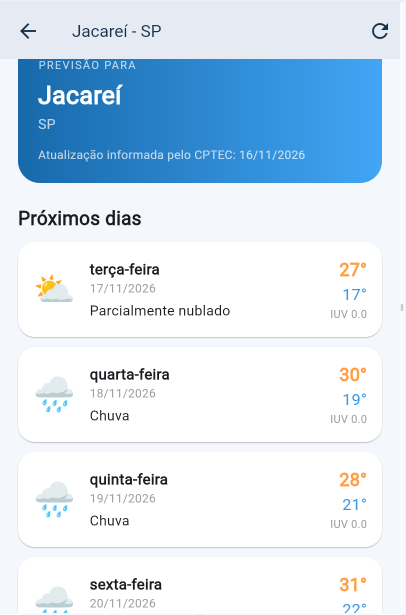
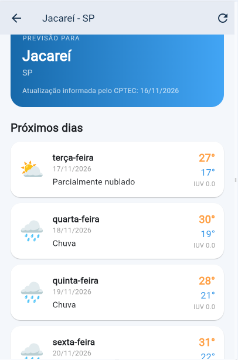

# Tempo Claro ☀

Aplicativo desenvolvido em Flutter para consultar a previsão do tempo de cidades brasileiras utilizando os dados do CPTEC/INPE.

## Funcionalidades

- Pesquisa de cidades brasileiras pelo nome.
- Exibição do nome, estado e identificador da cidade retornado pelo CPTEC/INPE.
- Consulta da previsão do tempo para quatro dias.
- Exibição das temperaturas mínima e máxima.
- Descrição das condições meteorológicas e ícones representativos.
- Exibição do índice UV quando disponibilizado pelo serviço.
- Conversão das siglas meteorológicas em descrições compreensíveis.
- Exibição da data de atualização informada pelo CPTEC/INPE.
- Atualização manual da previsão.
- Indicadores de carregamento e mensagens para erros de conexão, respostas inválidas, pesquisas sem resultados e ausência de previsão.
- Gráfico de linhas para comparar as temperaturas máximas e mínimas.
- Armazenamento local da última cidade selecionada.

## Tecnologias e bibliotecas

- **Flutter e Dart:** desenvolvimento da aplicação.
- **http:** realização das requisições HTTP.
- **xml:** leitura e interpretação dos arquivos XML.
- **shared_preferences:** armazenamento local da última cidade selecionada.
- **fl_chart:** construção do gráfico de temperaturas.
- **Node.js:** servidor intermediário utilizado na versão Web para permitir a comunicação com o serviço CPTEC/INPE.

## Serviço de dados

Os dados meteorológicos são obtidos do serviço oficial do CPTEC/INPE.

Documentação: https://servicos.cptec.inpe.br/XML/

Endereços utilizados:

- Pesquisa de cidades: `http://servicos.cptec.inpe.br/XML/listaCidades?city={nome}`
- Previsão de quatro dias: `http://servicos.cptec.inpe.br/XML/cidade/{id}/previsao.xml`

O nome da cidade é enviado sem acentuação na pesquisa. A consulta da previsão utiliza o identificador retornado pelo serviço, evitando códigos de cidades fixos no aplicativo.

## Persistência local

A última cidade selecionada, incluindo identificador, nome e UF, é armazenada localmente utilizando a biblioteca `shared_preferences`.

Ao abrir o aplicativo novamente, a cidade salva é recuperada e sua previsão é consultada novamente no CPTEC/INPE. Dessa forma, os dados meteorológicos são atualizados por meio do serviço, em vez de apresentar informações antigas como se fossem atuais.

## Como executar

### Pré-requisitos

- Flutter instalado e configurado.
- Dart instalado com o Flutter.
- Node.js 24 ou versão compatível com `fetch` e `AbortSignal.timeout` (necessário para a versão Web).

### Instalar as dependências

Clone o repositório e acesse sua pasta pelo terminal.

Execute:

```bash
flutter pub get
```

### Executar no navegador (Web)

A versão Web utiliza um servidor intermediário local em Node.js para contornar a restrição CORS do navegador ao acessar o serviço CPTEC/INPE.

Abra um primeiro terminal na pasta raiz do projeto e execute:

```bash
node ./proxy/server.js
```

Mantenha esse terminal aberto. O servidor ficará disponível em:

`http://127.0.0.1:3001`

Em um segundo terminal, também na pasta raiz do projeto, execute:

```bash
flutter run -d chrome
```

### Executar em Android

Na pasta raiz do projeto, execute:

```bash
flutter devices
```

Confira se o dispositivo Android está conectado e execute:

```bash
flutter run
```

A versão Android consulta diretamente o serviço CPTEC/INPE, sem utilizar o intermediário local da versão Web.

### Verificar o código

Para analisar o código:

```bash
flutter analyze
```

Para executar os testes:

```bash
flutter test
```

## Estrutura de pastas

```text
lib/
├── main.dart
├── models/
│   ├── cidade.dart
│   ├── dia_previsao.dart
│   └── previsao.dart
├── screens/
│   ├── busca_screen.dart
│   └── previsao_screen.dart
├── services/
│   ├── cptec_service.dart
│   └── preferencias_service.dart
└── widgets/
    └── grafico_temperatura.dart

proxy/
└── server.js

screenshots/
└── (capturas de tela do aplicativo)
```

## Capturas de tela

### Tela de pesquisa de cidades


### Previsão do tempo para quatro dias



### Gráfico de temperaturas



## Fonte dos dados

CPTEC/INPE — Centro de Previsão de Tempo e Estudos Climáticos / Instituto Nacional de Pesquisas Espaciais.

Documentação oficial: https://servicos.cptec.inpe.br/XML/